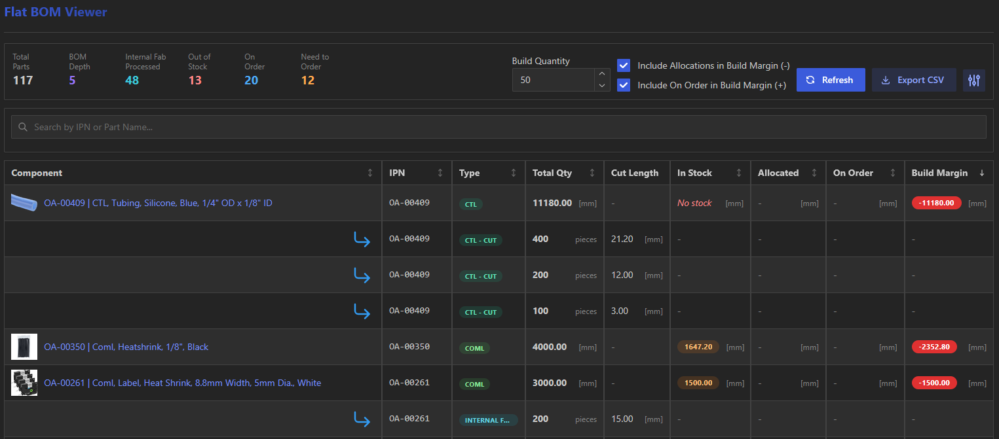
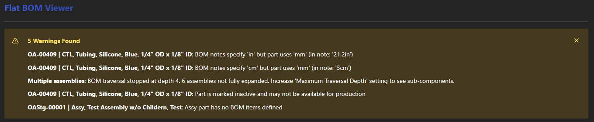
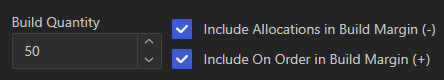
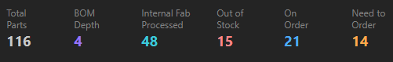
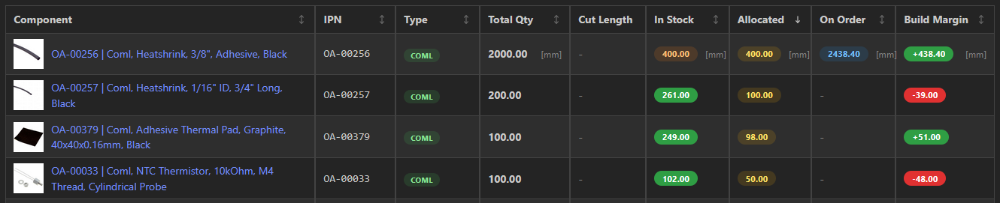

# Flat BOM Generator for InvenTree

**Version:** 0.11.53 | **InvenTree:** 1.6.0+

> Personal project to create a flattened BOM viewer for large assemblies in InvenTree. Currently stable after a refactor to improve code quality. Feedback and bug reports welcome!

InvenTree plugin that flattens nested bill of materials into a temporary single-level view of purchaseable components with automatic quantity aggregation. **The plugin is accessed via a "Flat BOM" panel on the part detail page of any assembly.**

## What This Plugin Adds

InvenTree's built-in BOM view shows only the first layer of a BOM's hierarchical structure. This plugin **flattens** that hierarchy into a purchasing-focused view by:

### Core Functionality

- **Automatic Line-Item Extraction**: Traverses the entire BOM tree and emits line items driven by assembly status and each part's primary supplier — external-supplier assemblies appear as purchased units, internal-supplier assemblies appear and are expanded, unsourced assemblies expand as build candidates
- **Quantity Deduplication**: When a part appears multiple times in different branches of the BOM, automatically aggregates the total quantity needed
- **Optional & Consumable Parts**: Displays badges for optional and consumable parts with smart aggregation logic (flag shown only if ALL instances have that flag)
- **Cut Lists**: BOM lines in length units (mm, m, ft...) get a piece breakdown — each entry shows the piece size and how many pieces the BOM demands, aggregated per part and size
- **Flexible Build Margin Planning**: Toggle between optimistic (ignore allocations) and realistic (account for allocated stock) planning modes
- **On-Order Awareness**: Choose whether to include incoming purchase orders in your Build Margin calculations
- **Upstream Shortage Signals**: Net Stock and To Order columns surface InvenTree's own shortage math — net position can go negative

### User Interface

- **Single-Page View**: See all purchaseable components in one table instead of navigating through BOM levels
- **Interactive Controls**: Adjust build quantity and instantly see scaled requirements across all parts
- **In-Panel Settings**: Configure generation settings (max depth, expand assemblies, cutlist options) directly in the UI with progressive disclosure
- **Planning Toggles**: Switch between planning scenarios (with/without allocations, with/without on-order, show/hide cutlists) in real-time
- **CSV Export**: Export the complete flat BOM with all calculated quantities for purchasing workflows

*Screenshot: Main panel view with controls and BOM table*  


### Warning System

The plugin automatically detects and flags potential BOM issues:

- **Unit Mismatch Detection**: Flags when parts at the same BOM level use different units (e.g., mixing "pcs" and "grams")
- **Inactive Part Detection**: Warns when BOM contains inactive parts that may not be orderable
- **Assembly Without Children**: Identifies assemblies marked as assemblies but with no BOM items defined
- **Max Depth Exceeded**: Alerts when BOM traversal hits the configured depth limit (prevents infinite loops)

Warnings appear in a summary panel and help identify data quality issues before manufacturing.
*Screenshot: warnings at top of table*  


### Why This Matters

When planning a build, you typically need to answer: "How many of X Y or Z parts to we need to build 50 of this assembly?" InvenTree's hierarchical BOM view requires manual traversal and calculation. This plugin automates that process by:

1. Traversing multi-level BOMs automatically
2. Aggregating duplicate parts across branches
3. Calculating cumulative quantities through the hierarchy
4. Presenting a single, actionable purchasing list

### Limitations

- This plugin generates a temporarily list to use as reference.
- It doesn't take into account in-stock assemblies in it's build margin calculations. 

### Performance Note

**Each generation request performs a complete recursive BOM traversal with no caching.** For large assemblies (1000+ parts, 10+ levels deep), this can take 10's of seconds. The plugin:
- Traverses every part in the BOM hierarchy from scratch
- Calculates cumulative quantities through all levels
- Filters and deduplicates results

Consider using the optional `max_depth` parameter for very deep BOMs to limit traversal depth if appropriate.

## Installation

### Install from GitHub

Add the following line to your InvenTree `plugins.txt` file (or install directly via pip):

```bash
git+https://github.com/jrobelia/inventree-flat-bom-generator.git
```

Then restart InvenTree and enable the plugin:

1. Navigate to **Settings → Plugins** in InvenTree
2. Find "Flat BOM Generator" in the list
3. Toggle to enable
4. Restart InvenTree

## Configuration

After enabling the plugin, configure it in **Settings → Plugins → Flat BOM Generator**:

### Plugin Settings

| Setting | Description | Default |
|---------|-------------|---------|
| **Fabrication Category** | InvenTree category for fabricated parts. Parts in this category (or child categories) get the Fab display label. Affects labels only, not expansion. | None |
| **Commercial Category** | InvenTree category for commercial/COTS parts. Parts in this category (or child categories) get the Coml display label. Affects labels only, not expansion. | None |
| **Show Substitute Parts** | Include substitute parts in the flat BOM by default (shown as child rows with individual stock levels). The panel's Include Substitute Parts toggle overrides this per run. | `False` |

Traversal and display toggles — **Maximum Traversal Depth**, **Expand Purchased Assemblies**, and **Include Substitute Parts** — are panel settings, not plugin admin settings: they live in the Flat BOM panel (stored in browser localStorage) and are sent to the API as query parameters per run.

**Note:** See the "Category Configuration Behavior" section below for detailed part categorization logic.

### Cut Lists

**Feature Overview**: Any BOM line whose sub-part's units resolve to a **length** dimension (mm, m, inch...) becomes a cut-list candidate — every piece it needs shows as a child row under the part, under whatever expanded assembly it sits. This uses InvenTree's native `piece_count` semantics: `quantity` is the size of one piece and `piece_count` is how many pieces the line calls for.

**How It Works**:
1. Give cut stock a length unit on the part record (e.g. `mm`)
2. Add it to BOMs with `quantity` = piece size and `piece_count` = pieces per build
3. The plugin will:
   - Total the material as `quantity × piece_count` through the tree (a 500mm × 4 line counts 2000mm)
   - Attach cut-list child rows to the part — one per piece size, each showing size and count scaled to build quantity
   - Aggregate entries by (part, piece size): the same part at 500×4 under one assembly and 500×2 under another shows a single `500 x 6` row; `500×4` + `250×8` stays two rows

**Cut-List Entry Semantics**:
- **Size** = the BOM item quantity (piece size, in the child's native unit)
- **Count** = pieces demanded, `ceil(piece_count × ancestor multiplier)`
- A `piece_count` of 1 still lists as one piece (`500 x 1`)
- Membership is decided by unit dimensionality only — notes are free text, never parsed, and which assembly the line sits under doesn't matter

### Internal-Supplier Assemblies

When an assembly's primary supplier is a company flagged **internal** (`Company.is_internal`), the plugin shows the assembly as a line item *and* expands its children into the flat BOM as raw-material pulls. Cut-list membership for those children follows the same length-unit rule as everywhere else.

### Understanding Default Suppliers

**Critical Concept:** Default suppliers determine how assemblies are treated during BOM traversal.

**Why This Matters:**
- **External Primary Supplier** → Assembly appears in flat BOM as a purchaseable unit (Purchased Assy), not expanded
- **Internal Primary Supplier** (`Company.is_internal`) → Assembly appears in flat BOM AND is expanded, showing its component parts (Internal Fab)
- **No Primary Supplier** → Assembly is expanded as a build candidate, showing its component parts (Standard Assy)

**Example Scenarios:**

1. **PCBA with External Supplier**: A circuit board assembled by a contract manufacturer
   - `is_assembly` = TRUE
   - `default_supplier` = "ACME PCB Assembly Co"
   - **Result**: Appears in flat BOM as "Purchased Assy", BOM is NOT expanded
   - **Why**: You purchase it complete, don't need to buy individual resistors/capacitors

2. **Internal Fabrication Assembly**: A CNC machined part made in-house
   - `is_assembly` = TRUE  
   - `primary supplier` = Your internal supplier company (`is_internal` flag set)
   - **Result**: Appears in flat BOM as "Internal Fab" AND its BOM IS expanded
   - **Why**: The row covers the internal work order; the expanded children are the raw materials needed (bar stock, etc.)

3. **Standard Assembly**: A sub-assembly built in-house
   - `is_assembly` = TRUE
   - `primary supplier` = None
   - **Result**: Does NOT appear in flat BOM, BOM IS expanded
   - **Why**: Plugin shows component parts you need to order or build, not the sub-assembly — it is a build-order candidate, not a purchase line

**Configuration Tip:** Set default suppliers correctly to control BOM traversal behavior. This is more important than category configuration for assemblies.

### Category Configuration Behavior

**Part Categorization Logic:**

Display labels (`part_type`) answer "what should this line item show?" — they do not drive expansion. Expansion is decided by `is_assembly`, the primary supplier, and the supplier company's `is_internal` flag:

| Part Type | is_assembly | Primary Supplier | Appears in Flat BOM | Expanded | Badge Color | Description |
|-----------|-------------|------------------|---------------------|----------|-------------|-------------|
| **TLA** | TRUE | any | ❌ NO | ✅ YES | Grape | The top-level part being flattened - input only, never a row |
| **Purchased Assy** | TRUE | external | ✅ YES | ❌ NO | Orange | PCBA, purchased complete from external supplier |
| **Internal Fab** | TRUE | internal (`is_internal`) | ✅ YES | ✅ YES | Cyan | CNC, 3D print - row covers the internal PO, children show raw materials |
| **Assy** | TRUE | none | ❌ NO | ✅ YES | Violet | Unsourced assembly - expanded as a build-order candidate |
| **Coml** | FALSE | any/none | ✅ YES | n/a | Green | Off-the-shelf commercial parts (Commercial category) |
| **Fab** | FALSE | any/none | ✅ YES | n/a | Blue | Fabricated parts (Fabrication category) |
| **Other** | FALSE | any/none | ✅ YES | n/a | Gray | Parts not matching configured categories |

**Expansion rules (independent of labels):**
- The top-level input part is exempt from the matrix: an assembly TLA always expands and never appears as a row in its own flat BOM (a childless unsourced TLA still emits the assembly_no_children warning)
- Non-assembly parts are always line items
- External-supplier assemblies are line items, expanded only via the "Expand Purchased Assemblies" toggle
- Internal-supplier assemblies are line items AND always expanded
- Unsourced assemblies are always expanded (regardless of `purchaseable`), and only appear themselves when they have no children (flagged as a warning)

**Configuration Impact:**

**When all categories are configured:**
- Plugin uses InvenTree category hierarchy to classify parts
- Supports parent + child categories (entire tree)
- All part types correctly identified

**When categories are NOT configured:**
- **Assemblies still work**: Assembly labels rely on `is_assembly` and the primary supplier's `is_internal` flag, not categories
- **Non-assemblies become "Other"**: No category mappings means Coml and Fab cannot be identified
- **Recommendation**: Configure both Fabricated and Commercial categories for accurate labels
- **Note**: Category configuration affects display labels only — expansion behavior is unchanged either way

**Partial configuration scenarios:**

| Categories Configured | What Works | What Doesn't |
|----------------------|------------|--------------|
| None | Assembly labels + all expansion behavior | Coml, Fab labels (all → "Other") |
| Fabricated only | Fab labels, assemblies | Coml (→ "Other") |
| Commercial only | Coml labels, assemblies | Fab (→ "Other") |
| Both categories | ✅ Full classification | None |

**Note:** The "Other" category means the plugin cannot determine the part type from available data. These parts will still appear in the flat BOM if they are leaf parts (non-assemblies without child BOMs).

## Usage

### Interactive UI Panel

The plugin adds a "Flat BOM Viewer" panel to assembly part pages:

1. **Navigate** to any assembly part in InvenTree
2. **Click** "Generate Flat BOM" to analyze the complete hierarchy
3. **Adjust** build quantity to see scaled requirements
4. **Toggle** allocation and on-order checkboxes to customize Build Margin calculation
5. **Search** and filter the results table
6. **Export** to CSV for further analysis or purchasing

### Controls

**Build Quantity**
- Set the number of units you plan to build
- All quantities scale automatically

**Include Allocations in Build Margin** (Checkbox)
- ✅ Checked: Build Margin based on available stock (total - allocations) - *Realistic view*
- ☐ Unchecked: Build Margin based on total stock - *Optimistic view*

**Include On Order in Build Margin** (Checkbox)  
- ✅ Checked: Incoming stock increases Build Margin - *Standard planning*
- ☐ Unchecked: Ignore incoming stock - *Conservative planning*

*Screenshot: Build quantity input and checkbox controls*  


### Statistics Panel

- **Total Parts**: Number of unique purchaseable components
- **Internal Fab Processed**: Number of Internal Fabricated Part assemblies expanded during BOM traversal
- **Out of Stock**: Parts with zero inventory
- **On Order**: Parts with incoming purchase orders
- **Need to Order**: Parts with Build Margin deficit (respects checkbox settings)

*Screenshot: Statistics panel with counters*  


### Table Columns

| Column | Description |
|--------|-------------|
| **Component** | Full part name with IPN prefix and variant (includes thumbnail image, clickable link) |
| **IPN** | Internal Part Number |
| **Description** | Part description |
| **Type** | Color-coded badge: Coml (green), Fab (blue), Purchased Assy (orange), Internal Fab (cyan), Assy (violet), TLA (grape), Other (gray) |
| **Category** | InvenTree part category name (empty if uncategorized) |
| **Flags** | Assembly, Purchaseable, and Internal Supplier indicators plus Optional (orange badge) and Consumable (yellow badge) |
| **Total Qty** | Required quantity for build (scales with build quantity) with [unit] |
| **Cut Length** | Piece size on cut-list child rows with [unit] |
| **Pieces** | BOM line piece count — how many pieces of `quantity` size the line needs |
| **Inherited From** | IPN of the ancestor part an inherited BOM line is defined on |
| **In Stock** | Total inventory (green if sufficient, orange if partial, red if none) with [unit] |
| **Allocated** | Stock reserved for builds and sales orders with [unit] (dimmed when checkbox unchecked) |
| **On Order** | Incoming stock from purchase orders with [unit] (dimmed when checkbox unchecked) |
| **Net Stock** | Upstream net position: stock on hand minus allocated plus on order (red badge when negative — a shortage; green when positive) with [unit] |
| **To Order** | Upstream suggested order quantity — demand minus stock, open orders, and in-production builds (orange badge when > 0) with [unit] |
| **Build Margin** | Balance after build (negative red badge if deficit, positive green badge if surplus; respects allocation and on-order checkboxes) |

All columns except **Category**, **Cut Length**, **Pieces**, and **Inherited From** are **sortable**, and the table is **paginated** (10/25/50/100/All per page).

*Screenshot: BOM table showing all columns with various part types and stock levels*  


## How It Works

### BOM Traversal Algorithm

The plugin uses a recursive traversal with the `visited.copy()` pattern:

1. **Traverse**: Build complete BOM tree with cumulative quantities
   - Uses `visited.copy()` to allow same part in different branches
   - Detects and prevents circular references
   - Calculates cumulative quantities through multiplication

2. **Filter**: Apply the line-item / expansion matrix
   - Non-assembly parts: always line items
   - External-supplier assemblies: line items (children hidden unless expanded)
   - Internal-supplier assemblies: line items, always expanded
   - Unsourced assemblies: always expanded as build candidates

3. **Deduplicate**: Sum quantities for parts appearing multiple times
   - Groups by part_id
   - Aggregates cumulative quantities
   - Preserves metadata

### Stock Calculations

**Total Stock** = Physical inventory in InvenTree

**Allocated** = `allocation_count()` - Stock reserved for:
- Build orders (in production)
- Sales orders (promised to customers)

**Available** = Total Stock - Allocated

**Net Stock** = `Part.net_stock` (upstream) = Total Stock - Allocated + On Order
- Can go negative; a negative value is a shortage signal the floored `available` hides

**To Order** = `Part.quantity_to_order` (upstream) = open order demand minus the larger of stock-on-hand and minimum stock, minus on-order and in-production quantities (floored at 0)

**Build Margin** = Stock Used + (On Order if enabled) - Total Required
- Where Stock Used = Available (if allocations enabled) or Total Stock (if disabled)
- Negative value indicates deficit (need to order)
- Positive value indicates surplus (extra stock after build)

## Known Limitations

### Variant Stock Aggregation -- Not Supported

**Current Behavior**: The plugin shows stock for the specific part in the BOM, not aggregate variant stock. BOM lines inherited from a template part are shown, marked with their source in the `Inherited From` column. Variant stock aggregation (template parts, `allow_variants` flag) is **out of scope** for this plugin.

**Impact**:
- Template parts (with variants) show zero stock (actual stock is on the variant children)
- BOM items with "allow any variant" enabled don't show total available variant stock
- Cannot see which specific variant has best availability for purchasing decisions

**Why This Happens**: The plugin uses `part.total_stock` (specific part only), not `part.variant_stock` (sum across all variants).

**Example Scenario**:
```
BOM calls for: "Resistor 10K" (template part, allow_variants=True)
Available variants:
  - Resistor 10K 0805: 100 in stock
  - Resistor 10K 1206: 50 in stock

Plugin shows: 0 in stock (template has no physical stock)
Reality: 150 total across variants (any could fulfill requirement)
```

**Why Not Planned**: Correctly respecting `allow_variants` requires per-BomItem flag tracking through the entire traversal, deduplication, and stock calculation pipeline. The effort (8-10 hours) outweighs the value for this plugin's use case. Users who need variant-aware BOM analysis should use InvenTree's built-in BOM view and build order system, which handles variants natively. See [DEC-008 in decisions.md](docs/decisions.md) for full rationale.

## Future Work

### Planned Features

**Status**: v0.11.53 -- substitute parts, checkbox UX, and test infrastructure complete. Future work focuses on UX polish and new display features.

1. **Mixed Flag Handling** (HIGH) - Separate line items when the same part has different optional/consumable flags across BOM lines
2. **Child Row Visual Consistency** (MEDIUM) - Unified styling for cut-list, substitute, and mixed-flag child rows that feels InvenTree-native
3. **UI Overhaul: Control Bar** (MEDIUM) - Replace checkbox clutter with a cleaner pattern (dropdown menu, collapsible panel, or toolbar redesign)
4. **Pre-Generation Info Panel** (LOW) - Explain plugin-specific features before the user hits Generate
5. **Rows-Per-Page Fix** (LOW) - Replace "All" with 500/1000 to match InvenTree's standard pagination
6. **InvenTree Export Integration** (LOW) - Replace custom CSV with InvenTree's built-in export system (CSV, JSON, XLSX)

See [docs/ROADMAP.md](docs/ROADMAP.md) for detailed implementation plans and prioritization.

### Related Plugins

This is the first of three planned plugins to enhance InvenTree's manufacturing planning capabilities for assemblies with nested sub-assemblies:

1. **Flat BOM Generator** (this plugin) - Flattens nested BOMs into a purchasing-focused view with stock analysis, substitute parts, and build margin planning
2. **Build Order Generator** (planned) - Traverses the BOM tree and creates InvenTree build orders for every sub-assembly that needs building, with an interactive preview tree before creation
3. **Purchase Order Generator** (planned) - Automates PO generation from flat BOMs using default supplier logic and project-based part allocation

Each plugin produces actionable but temporary output for manufacturing and purchasing workflows. They share conventions (DRF serializers, React/Mantine frontend, Vitest testing) but are independent codebases -- no shared library required.

